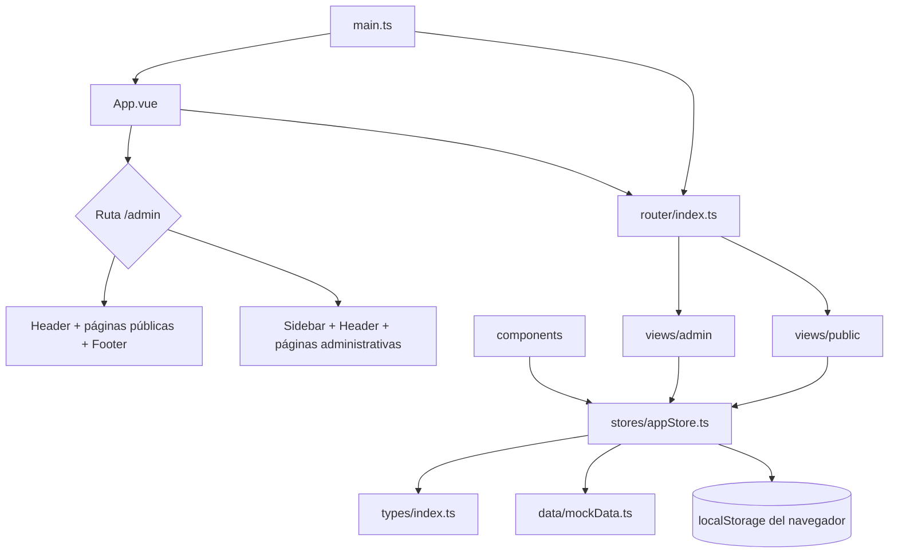

# Mapa del proyecto SIGCA

**Revisado:** 2026-10-15  
**Estado observado:** frontend de demostración basado en `localStorage`; API parcial con Mongo para autenticación, usuarios y servicios. No asumir que el resto de módulos tiene persistencia o autorización de servidor.

Este documento es el índice de contexto del repositorio. Actualízalo cuando cambien rutas, módulos principales, modelo de datos, persistencia o comandos. La navegación y el modelo fuente de verdad siguen siendo los archivos de `src/`.

## Vista de arquitectura



### Puntos de entrada y responsabilidades

| Área | Ubicación | Responsabilidad |
|---|---|---|
| Arranque | `src/main.ts` | Crea Vue, instala Pinia y Vue Router, monta `App.vue`. |
| Shell | `src/App.vue` | Decide layout público/administrativo según prefijo `/admin`; monta modal global de comprobante. |
| Rutas | `src/router/index.ts` | Define rutas públicas y administrativas; no configura guards ni autorización. |
| Estado/dominio | `src/stores/appStore.ts` | Store Pinia único: datos, acciones de negocio y persistencia manual. |
| Contratos | `src/types/index.ts` | Tipos de usuarios, pacientes, citas, pagos, caja, materiales y contenido. |
| Datos de demo | `src/data/mockData.ts` | Semillas locales para la demostración. |
| API | `backend/src/server.ts` | Express, conexión Mongoose, healthcheck y rutas de auth/usuarios. |
| Usuarios | `backend/src/modules/users/` | Esquema de usuario, hash de contraseña y endpoints administrativos. |
| Autenticación | `backend/src/modules/auth/` | Login JWT, verificación de usuario activo y autorización por rol. |
| Servicios | `backend/src/modules/services/` | Catálogo público de activos y CRUD administrativo; precios en centavos enteros. |
| Bootstrap | `backend/src/seed/bootstrapAdmin.ts` | Alta única del administrador inicial desde variables locales. |
| Imagen de API | `backend/Dockerfile` | Compila TypeScript y ejecuta el servidor Node. |
| Componentes comunes | `src/components/public/`, `src/components/admin/` | Headers, navegación y modales compartidos. |
| Vistas | `src/views/public/`, `src/views/admin/` | Pantallas asociadas a las rutas. |
| Estilos | `src/index.css` | Tailwind v4, tokens globales y reglas de impresión. |
| Diseño de referencia | `docs/07-diseno/` | 29 prototipos HTML; `serene_harmony/DESIGN.md` documenta tokens visuales. |

## Módulos y rutas

**Público**

| Ruta | Vista | Función |
|---|---|---|
| `/inicio` | `HomeView.vue` | Inicio del portal. |
| `/servicios` | `ServicesView.vue` | Catálogo de servicios. |
| `/mision-vision` | `MissionVisionView.vue` | Información institucional. |
| `/educativo` | `EducationalView.vue` | Contenido educativo. |
| `/corporativo` | `CorporateView.vue` | Oferta corporativa. |
| `/horarios-contacto` | `ScheduleContactView.vue` | Horarios y contacto. |
| `/agendar-cita` | `BookingRequestView.vue` | Solicitud pública de cita. |

**Administrativo**

| Prefijo de ruta | Vista | Función |
|---|---|---|
| `/admin/dashboard` | `DashboardView.vue` | Resumen operativo. |
| `/admin/pacientes` | `PatientsView.vue` | Pacientes. |
| `/admin/responsables` | `GuardiansView.vue` | Responsables/tutores. |
| `/admin/servicios` | `ServicesAdminView.vue` | Catálogo administrable. |
| `/admin/solicitudes` | `RequestsView.vue` | Bandeja de solicitudes. |
| `/admin/citas` | `AppointmentsView.vue` | Programación y gestión de citas. |
| `/admin/calendario` | `CalendarView.vue` | Agenda visual. |
| `/admin/materiales` | `MaterialsView.vue` | Materiales educativos. |
| `/admin/pagos` | `PaymentsView.vue` | Pagos y saldos. |
| `/admin/caja-diaria` | `CashRegisterView.vue` | Apertura, movimientos y cierre de caja. |
| `/admin/contenido` | `InstitutionalContentView.vue` | Contenido institucional. |
| `/admin/usuarios` | `UsersView.vue` | Usuarios y roles de demostración. |
| `/admin/mensajes` | `MessagesView.vue` | Mensajes recibidos. |

`/` redirige a `/inicio`; `/admin` redirige a `/admin/dashboard`.

## Estado y flujo de datos

- `useAppStore` es el almacén común de las vistas Vue. Las entidades principales incluyen usuarios, pacientes, responsables, servicios, citas, solicitudes, pagos, caja, materiales, contenido y mensajes.
- `mockData.ts` proporciona los datos iniciales. El store lee/escribe JSON en `localStorage` con el prefijo `sigca_armonia_vue_`; cada acción de mutación llama a `persistAll()`.
- Las solicitudes, mensajes y catálogo que ve actualmente Vue se mantienen en ese store local; el frontend todavía no consume la API.
- La API Express persiste usuarios y servicios en MongoDB. El catálogo público expone solo servicios activos; el CRUD completo de servicios está protegido para `ADMIN`.
- El selector del sidebar cambia el usuario/rol de demostración y filtra enlaces visibles. Esto no equivale a autenticación ni autorización: el router no bloquea rutas directas.
- El comprobante es una vista imprimible local. La consigna excluye explícitamente facturación electrónica, así que SAT-FEL no es criterio de aceptación; la etiqueta “SAT-FEL OK” y las afirmaciones del README sí deben aclararse para no prometer una integración inexistente.

## Desarrollo y validación

Requisitos: Node.js y npm. Scripts definidos en `package.json`:

```bash
npm install
npm run dev       # Vite en 0.0.0.0:3000
npm run lint      # vue-tsc --noEmit
npm run build     # vue-tsc y build de producción
npm run preview   # Vista previa en puerto 3000
```

Validación de esta revisión: `npm run build` y `npm run build --prefix backend` completaron correctamente el 2026-10-15. Se probó manualmente el CRUD de servicios, precios en centavos y controles de rol con documentos sintéticos, limpiados al finalizar. No hay suite de pruebas automatizadas definida.

## Evaluación y prioridades

**Fortalezas observadas:** separación clara entre vistas públicas y administrativas; tipos de dominio explícitos; un store reutilizado por ambos flujos; build de producción correcto; prototipos de diseño y tokens visuales documentados.

**Límite principal:** tratar el sistema como demostración, no como sistema clínico desplegable. Ya existe API con Mongo para auth, usuarios y servicios, pero la mayoría de las vistas sigue usando `localStorage` y las reglas de citas/pagos/caja aún no están implementadas en servidor. No introducir datos personales reales.

**Siguientes prioridades antes de uso real:**

1. Conectar el frontend al login y a la API de servicios; implementar guards visuales como complemento de la autorización del servidor.
2. Extender API/Mongo a pacientes, responsables y citas, aplicando allí las reglas de negocio.
3. Diseñar privacidad, auditoría, retención y protección de información clínica conforme a las obligaciones aplicables.
4. Añadir pruebas de flujos críticos: solicitud→cita, cálculo de saldo, pagos y cierre de caja.
5. Alinear el README con la consigna y los tipos: los únicos métodos requeridos son efectivo, transferencia y tarjeta; el README menciona cheque y SAT-FEL, que no forman parte del alcance obligatorio.
6. Resolver la configuración de dependencias: `bun.lock` está versionado, mientras `package-lock.json` aparece sin seguimiento. Se añadieron `.gitignore` y `.dockerignore`; decidir un solo gestor de paquetes y qué lockfile conservar antes de preparar el commit.
7. Crear una cuenta MongoDB de aplicación con privilegios mínimos; Compose aún entrega la cuenta root al backend y eso es solo para desarrollo.

### Alineación con la consigna académica

La consigna en `docs/Proyecto_-Sistema-Integral-de-Gestion-de-Citas-y.md` exige backend Node.js/Express, MongoDB/Mongoose, API REST, autenticación JWT y persistencia real. El estado es una demo frontend: no cumple todavía el alcance Full Stack ni se deben considerar operativas las transacciones simuladas del navegador.

| Requisitos | Estado observado |
|---|---|
| RF-01 portal público | Vistas y formularios presentes; solicitudes, mensajes y contenido no persisten en MongoDB. El catálogo aún no consume la API. |
| RF-02 autenticación y roles | API de login JWT, cuentas inactivas bloqueadas y permisos de servidor para usuarios/servicios; falta pantalla de login y protección en Vue para los demás módulos. |
| RF-03–04 pacientes y responsables | Pantallas y datos locales; API/Mongo todavía no implementados. |
| RF-05 servicios | CRUD API en Mongo con autorización ADMIN y precios en centavos; falta conectar las vistas Vue. |
| RF-06 solicitudes | Formulario y bandeja local presentes; no se persiste en servidor. |
| RF-07–08 citas y calendario | Vistas locales presentes; las reglas de disponibilidad y transiciones deben validarse en backend. |
| RF-09 materiales | Pantalla y asignación local presentes; falta API/DB. |
| RF-10 pagos | Parcial: admite montos positivos en UI y calcula saldo por paciente; el tipo de pago no requiere cita, no contempla anulaciones/estado, ni evita sobrepagos, y el comprobante aleatorio no garantiza unicidad. Usa `number` decimal. |
| RF-11 caja | Parcial: una sola caja local; faltan historial multi-caja/usuario, efectivo contado y diferencia, asociación obligatoria de pagos y bloqueo real de caja cerrada. |
| RF-12 contenido | Vista local presente; falta persistencia en MongoDB. |
| RF-13 usuarios | API administrativa, bcrypt, activación/desactivación y cambio de contraseña por ADMIN; falta integración de interfaz y recuperación segura de contraseña. |
| RN-01–30 | No hay cumplimiento verificable en servidor; algunas comprobaciones existen solo en UI. Implementar y probar del lado API antes de considerar las reglas cumplidas. |
| API, base Mongo/Mongoose | Implementación inicial de auth, usuarios y servicios; faltan los demás módulos y seeds completos de la consigna. |
| Entregables | `.env.example`, Docker y backend base presentes; faltan colección Postman, datos completos, README de credenciales ficticias y pruebas automatizadas. |

Docker y Docker Compose están disponibles en el entorno de revisión. `compose.yaml` incluye MongoDB oficial con healthcheck y volumen persistente, además de la API Express/Mongoose. En el Docker de este workspace se observó que contenedores hermanos no alcanzan por TCP Mongo; desde el workspace sí funciona `127.0.0.1:27017`, por lo que Mongo corre en Compose y la API en el host para desarrollo. La API implementa autenticación JWT y administración de usuarios/servicios con RBAC; `GET /api/servicios` expone solo activos. Los precios de servicios se almacenan en centavos enteros. El frontend todavía no consume esos endpoints. Pruebas sintéticas de login, permisos y CRUD de servicios pasaron; documentos creados durante las pruebas fueron limpiados. El entorno local requiere `JWT_SECRET` y un administrador bootstrap. En Docker normal, API y Mongo permanecen en la red interna Compose. La API usa todavía el usuario Mongo root en desarrollo; debe reemplazarse por un usuario de aplicación de privilegios mínimos antes de producción. El frontend aún no está en Compose.

## Cómo mantener este mapa

- Al añadir una ruta, actualizar la tabla de rutas y confirmar el registro en `src/router/index.ts`.
- Al cambiar persistencia, entidades o permisos, actualizar “Estado y flujo de datos” y “Evaluación”.
- Al cambiar scripts o herramientas, actualizar “Desarrollo y validación”. No registrar resultados de build como permanentes: volver a ejecutar la comprobación y fecharla.
- Mantener aquí referencias y decisiones estructurales; no copiar implementaciones completas. Los archivos fuente siguen siendo la autoridad.
