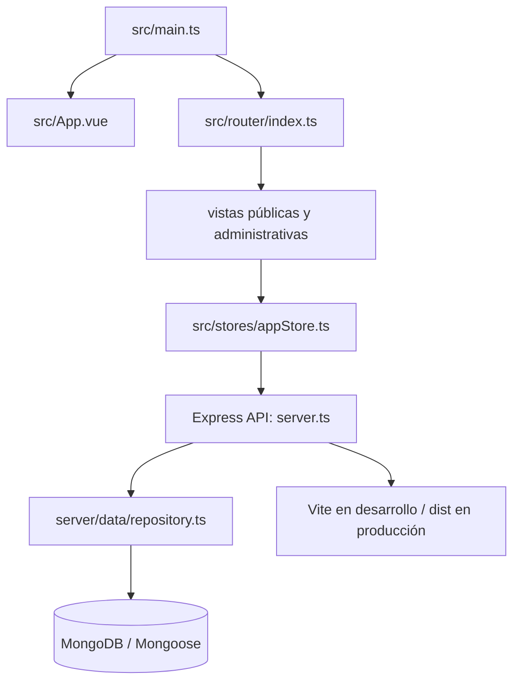

# Mapa del proyecto SIGCA

**Revisado:** 2026-10-16
**Estado:** se usa el backend integrado `server.ts` como entrada principal. El API alterno de `backend/` permanece parcial y separado. La integración corregida aún necesita una ejecución contra MongoDB para considerarse verificada end-to-end. El build Compose falló en `npm ci` dentro de Docker (`Exit handler never called!`); el build local sí pasa.

Este documento distingue la consigna académica (`Proyecto_-Sistema-Integral-de-Gestion-de-Citas-y.md`) del estado observado en el código. La consigna define el alcance esperado; este mapa ubica la implementación actual.

## Arquitectura y flujo

| Área | Ubicación | Función / estado |
|---|---|---|
| Frontend | `src/main.ts`, `src/App.vue` | Vue 3, Pinia, Vue Router, layouts público y administrativo. |
| Navegación | `src/router/index.ts` | Rutas públicas/privadas y guard por roles; restaura sesión llamando `/api/auth/me`. |
| Store/API | `src/stores/appStore.ts` | Estado de vistas, token JWT y consumo de rutas relativas `/api`. Las escrituras fallidas no deben convertirse en datos locales exitosos. |
| Backend activo | `server.ts`, `server/routes/` | Express y Vite en el mismo origen; API de auth, usuarios, pacientes, responsables, servicios, citas, solicitudes, materiales, pagos, cajas, contenido, horarios, contacto y reportes. |
| Persistencia | `server/config/db.ts`, `server/data/repository.ts`, `server/models/` | MongoDB/Mongoose requerido al iniciar; semilla para colecciones vacías y carga de colecciones al caché del repositorio al arrancar. |
| Backend alterno | `backend/src/` | API parcial de auth, usuarios y servicios; no es el destino de `npm run dev` ni del Compose principal. |
| Diseño | `docs/07-diseno/` | Prototipos de pantallas y tokens visuales. |

En **Programar Cita**, el frontend admite paciente existente o alta de paciente nuevo; si es menor, solicita los datos obligatorios del responsable y lo asocia. La consulta de disponibilidad es `GET /api/citas/disponibilidad` y está declarada antes de la ruta genérica `GET /api/citas/:id`. Un 404 con el texto `Cita no encontrada` al consultar disponibilidad indica que el proceso backend activo no cargó esta ruta; reinícialo antes de volver a probar.

## Rutas principales

**Portal:** `/inicio`, `/servicios`, `/mision-vision`, `/educativo`, `/corporativo`, `/horarios-contacto`, `/agendar-cita`.

**Administración:** `/admin/dashboard`, `/admin/pacientes`, `/admin/responsables`, `/admin/servicios`, `/admin/solicitudes`, `/admin/citas`, `/admin/calendario`, `/admin/materiales`, `/admin/pagos`, `/admin/caja-diaria`, `/admin/contenido`, `/admin/usuarios`, `/admin/mensajes`.

## Ejecución

- `npm run dev`: API integrada y Vite en `http://localhost:3000`.
- `npm run build`: chequeo TypeScript del frontend y build de Vite.
- `npm run lint`: chequeo de tipos del frontend.
- `npm test`: ejecuta `scripts/test-api.ts`.
- `npm run seed`: ejecuta `scripts/seed.ts`; agrega fixtures a colecciones vacías. Solo borra datos con `SEED_RESET=true` explícito.
- Compose integrado en `compose.yaml` requiere `JWT_SECRET`; su build no quedó validado: en este entorno `npm ci` dentro del contenedor falla antes de instalar dependencias.

El backend necesita `MONGODB_URI` accesible y `JWT_SECRET` de al menos 32 caracteres. `.env.example` es una plantilla; no contiene una clave lista para producción. En Docker Compose, Mongo queda sin autenticación y la configuración es para desarrollo/demo local.

## Evaluación del alcance

Las pantallas y rutas para la mayoría de los módulos existen. El backend integrado implementa rutas y modelos para los módulos principales, reglas de citas, pagos y caja. Esta inspección de código no demuestra por sí sola la persistencia ni el cumplimiento end-to-end. No afirmar las RN-01 a RN-30 como aprobadas hasta ejecutar los flujos contra Mongo y comprobar reinicios, errores, roles y concurrencia.

Correcciones de esta revisión: conexión Mongo obligatoria; carga de datos existentes desde Mongo en el arranque; retiro de la sesión ADMIN ficticia; restauración de sesión contra `/auth/me`; y eliminación del fallback local de las escrituras de paciente, responsable, servicio, solicitud, cita y pago.

## Pendientes relevantes frente a la consigna

1. Ejecutar y corregir build/lint y la suite existente; después validar con Mongo limpio y Mongo con datos previos.
2. Probar persistencia tras reinicio de todos los módulos y corregir errores que aparezcan.
3. Revisar atomicidad/concurrencia de pagos, anulaciones y cierres de caja.
4. Verificar que cada formulario presente errores HTTP al usuario y refresque los datos persistidos.
5. Completar o retirar el API parcial de `backend/` para evitar dos contratos en el repositorio.
6. Confirmar que el seed académico cubra los datos mínimos y que las credenciales ficticias estén documentadas.
7. Añadir evidencia reproducible de la secuencia solicitud → cita → pagos → caja y de autorización por rol.

No se considera sistema clínico de producción. Usar únicamente datos ficticios hasta completar las revisiones de privacidad, auditoría y seguridad.
